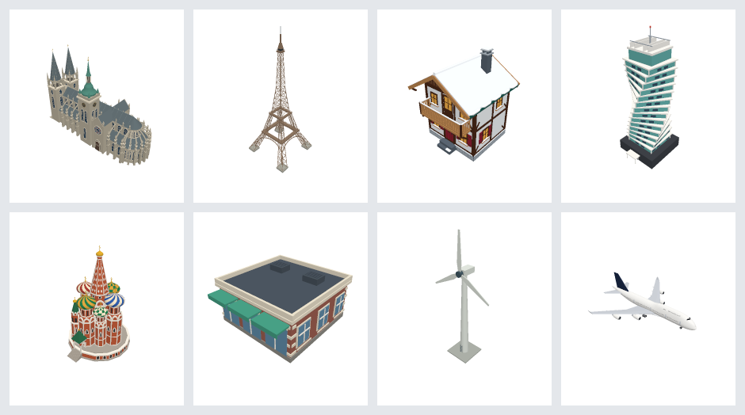
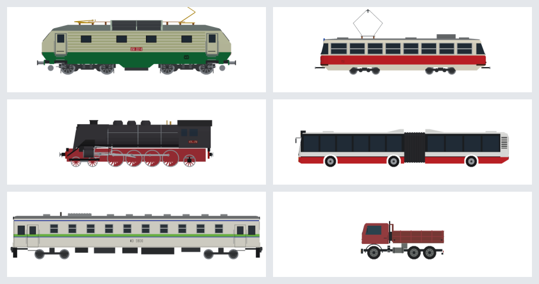

# Rail Island Factory

**The workshop where the buildings and vehicles of [Rail Island](https://railisland.com) are made - and where you can make your own.**

Every model you see at [factory.railisland.com](https://factory.railisland.com) - the
locomotive your trains pull, the tram in your town, the cathedral on the hill - is
built here. You don't need to know 3D modelling or programming to add one: you
describe what you want, and an AI assistant builds it, shows you pictures and
improves it until you're happy.





## What you can make

- **Buildings** - houses, shops, churches, stations, factories, famous landmarks.
- **Rail vehicles** - locomotives, railcars, coaches, freight wagons, trams, metro.
- **Road vehicles** - buses (including articulated ones), trucks, vans.
- **Others** - aircraft, ships, cable car cabins.

Many models come in **variants**: one house in several colours and sizes, one
locomotive in each of its historical liveries. In the game, wheels steer,
articulated buses bend and steam locomotives' rods move.

## Make your first model

You need a free [GitHub](https://github.com) account and access to
[Claude Code on the web](https://claude.ai/code). You don't install anything,
and it works in the browser or on your phone.

1. **Get your own copy of this project.** On GitHub, press **Fork** at the top of
   this page. Your copy is where your model is built, and nothing you do there
   can break anything else.
2. **Open it in Claude Code.** Go to [claude.ai/code](https://claude.ai/code),
   connect your GitHub account and pick your copy of `rail-island-factory`.
3. **Describe the model.** Write what you want, as you would to a friend who is good
   at modelling. Attach photos if you have them (a side view and a front view help
   the most). For example:

   > Add the British Class 37 diesel locomotive in the BR blue livery of the
   > 1970s. I attached two photos.

   > Add a small wooden railway station like the ones on Austrian branch lines,
   > with a waiting room, a canopy over the platform and flower boxes.

   > Add a variant of the Karosa bus in the blue livery of the Brno transport
   > company.

4. **Look at the pictures and say what to change.** The assistant builds the
   model and sends you images of it right in the chat - from the side, the front
   and at an angle, and every variant side by side. Reply with what you'd like
   different: "the roof should be steeper", "the windows are too small", "make
   the stripe darker red". Repeat until it looks right.
5. **Send it in.** Ask the assistant to "open a pull request". We review it, and
   once it is accepted your model appears on
   [factory.railisland.com](https://factory.railisland.com) and is ready to come
   to the game.

### Tips for a good model

- **Real things work best.** Name the real vehicle or building, its era and its
  colours. The assistant can look up dimensions and reference photos itself.
- **Change one thing at a time** when you ask for corrections - the pictures
  make it easy to see what changed.
- **Models are light on purpose.** The game shows thousands of them at once, so
  they keep a simple, clean style without tiny details.
- **The photos you share are kept with the model** as its references, so only
  attach pictures you are allowed to share.

## Browse the catalog

[factory.railisland.com](https://factory.railisland.com) lists every model with
an interactive 3D preview. Search, sort, open a model, turn it around, switch its
variants, and look at the photos and drawings it was made from.

## For developers

The models are TypeScript code that generates the geometry. The catalog site is
built with Solid, Vite and three.js. Setup, scripts, how models are exported to
the game and how each family of models is built are all in
[`docs/`](docs/README.md); [AGENTS.md](AGENTS.md) holds the rules for AI
assistants working on the project.

```bash
pnpm install
pnpm dev     # run the site on http://localhost:5173 (models are built on demand)
pnpm test
```

## License

This project is licensed under the [MIT License](LICENSE).
Third-party reference assets retain their respective licenses, documented in
each asset folder's `SOURCES.md`.
